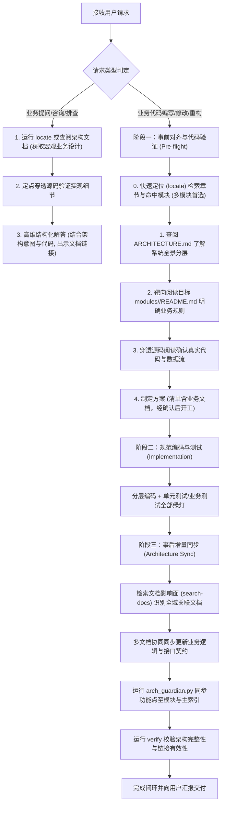

# 🛡️ Architecture Guardian (架构守护者)

本 Skill 旨在解决软件工程随业务迭代膨胀而导致“架构腐化（Architecture Drift）”及“AI 遗忘全局架构”的工程痛点。它通过建立**“事前查架构/秒级定位、事中遵规范、事后同架构”**的确定性双向闭环，确保无论是**日常业务问答咨询**还是**业务代码开发迭代**，项目的架构文档与真实业务代码始终保持强一致性与高可见度。

---

## ⚡ 操作场景与直接执行边界规范 (Execution Boundaries)

为避免繁琐的交互，特对操作场景作如下严格边界划分：

1. **【场景 A：纯架构文档指令 (Direct Tooling Commands)】—— 立即直接执行，严禁出方案拦截**
   - **适用指令**：用户显式要求“初始化架构文档”、“快速定位架构说明 (locate)”、“生成/更新模块说明”、“同步架构变更”、“检索文档影响面”、“记录 ADR”、“校验架构完整性”等纯文档与元数据维护命令。
   - **行为准则**：属于**确定性辅助工具操作（Deterministic Tooling Execution）**，AI **必须直接运行 `arch_guardian.py` 或直接创建/更新目标 Markdown 架构文档**，执行完毕后直接展示生成的架构全景与文件链接，**严禁多此一举地输出等待确认的《实施方案》**！

2. **【场景 B：业务功能/代码开发 (Business Code Implementation)】—— 严格遵循前置方案确认**
   - **适用指令**：用户要求编写、重构或修改具体的工程业务代码（如 API、Controller、Service、领域模型、数据库持久化逻辑等）。
   - **行为准则**：严格执行全局架构红线，必须先遵循“阶段一”查阅/定位架构文档并穿透源码验证，向用户提供《业务功能实施方案》，经用户明确确认后再编写代码与测试，并在测试绿灯后进入“阶段三”完成架构同步闭环。

3. **【场景 C：业务咨询、问答与排查定位 (Business Inquiry & Q&A)】—— 强制“先查架构库，再核验代码”**
   - **适用指令**：用户询问任何业务流程、功能逻辑、系统分层、状态机流转、接口契约或模块职责（如“xxx功能是怎么实现的？”、“这个系统里超时关单逻辑在哪个类？”、“订单状态有哪些？”）。
   - **行为准则**：**严禁直接埋头全量盲读源码**！必须遵循以下问答三步法（Inquiry SOP）：
     - **第 1 步（秒级定位）**：优先运行 `locate <业务关键词...>` 或查阅 `modules/<module>/README.md`，获取系统设计的宏观时序流、领域模型与规则定义；
     - **第 2 步（代码印证）**：根据架构文档中索引的核心类与关键方法，直接定点阅读源码，核实最新代码实现细节；
     - **第 3 步（高维解答）**：结合“架构设计意图 + 真实代码细节”输出高信息密度的结构化回答，并在回答中附带指向具体架构说明的 Markdown 超链接。

---

## 核心工作流闭环 (The Two-Way Architecture Loop)



---

## 阶段一：事前架构对齐与实体验证 (Pre-flight Check)

在动手编写或修改任何业务代码之前，**必须**严格遵循“**先查架构文档 -> 定位业务逻辑 -> 穿透代码确认 -> 制定方案开工**”的递进准则：

### 0. 快速章节级定位检索 (Fast Section Locator) 【多文档/大工程推荐】
当工程沉淀了多个业务模块，或需要快速搜索某一特定业务说明（如退款、分布式锁、鉴权逻辑、特定接口名）时，**严禁盲目逐个打开所有模块文档通篇全量阅读**！
优先运行 `locate` 命令：
```bash
python "<SKILL_DIR>/scripts/arch_guardian.py" --workspace "<项目绝对路径>" locate <keywords...> [--arch-dir "<共享架构目录>"]
```
- **秒级定位**：工具会自动解析 Markdown 标题层级栈，输出匹配模块、章节面包屑路径（如 `modules/order/README.md > ## 3. 核心业务流程 > ### 3.2 订单超时与退款流转 [L85]`）及精确行号。
- **靶向精读**：根据定位出的具体文档与行号区间，直接使用 `read_file` 定点阅读目标章节，极速完成前置调研，避免无效上下文膨胀。

### 1. 查架构总览与分布式指针 (Scan Architecture Blueprint)
检查工作区根目录是否存在 `.arch-guardian.json` 配置指针或 `docs/architecture/ARCHITECTURE.md`：
- **分布式/多工程场景**：若根目录存在 `.arch-guardian.json`，工具将自动路由至其指定的共享中心架构库（支持相对或绝对路径）。
- **若架构文档不存在**：优先执行初始化命令搭建架构骨架（可指定 `--arch-dir` 统一归集）：
  ```bash
  python "<SKILL_DIR>/scripts/arch_guardian.py" --workspace "<项目绝对路径>" init --name "<项目名称>" [--arch-dir "<共享架构目录>"]
  ```
- **若已存在**：必须先使用 `view_file` 阅读对应架构库中的 `ARCHITECTURE.md`，宏观掌握全局技术分层、通用约束与业务模块索引矩阵。

### 2. 定位业务模块与业务逻辑 (Locate Domain Module Logic)
- 判断本次需求是扩展**已有业务模块**还是引入**全新业务域**。
- 若为已有模块，打开 `docs/architecture/modules/<module_name>/README.md`，深入理解已有的**业务时序流、领域模型、核心接口与依赖边界**，严禁破坏既有领域划分或重复造轮子。

### 3. 穿透源码实体验证 (Ground Truth Code Verification) 【核心红线】
- 依据模块业务文档中列出的核心类、接口与关键代码路径，使用代码查看工具（如 `read_file`、`search_code`）**深入真实源码进行事实比对**：
  - 核对真实代码逻辑是否与文档描述一致，确认实际方法签名、入参出参以及返回值模型；
  - 查验核心业务规则的分支条件、异常处理、数据库持久化方式及缓存机制；
  - **严禁**仅凭文档或记忆脑补代码实现，必须以“代码真实运行逻辑”为事实锚点。

### 4. 出具《实施方案》与确认开工
- 基于前三步调研的事实依据，向用户提交严谨的《实施方案》；
- **【方案清单强制红线】**：方案中的“拟修改文件清单”**必须显式包含对应的业务逻辑说明文档**（如 `docs/architecture/modules/<module_name>/README.md`）。未包含文档的方案一律视为不合格方案，严禁开工。
- 经用户明确确认后，方可进入“阶段二”编写代码。

---

## 阶段二：规范编码与测试 (Implementation)

1. **坚持架构工程美学**:
   - 严格遵循项目的分层原则（如 Controller -> Service -> Repository / Infrastructure）。
   - 依赖注入，接口隔离，杜绝单体大文件（单文件建议 500 行以内，严禁超过 800 行）。
2. **测试与质量闭环**:
   - 编写单元测试与业务集成测试，确保功能完整验证，无报错。

---

## 阶段三：事后架构增量同步 (Post-implementation Sync)

业务代码与测试编写验证完成之后，**必须**同步更新架构文档库。**【完工验收红线 (Definition of Done)】：仅代码测试通过不能算任务完成，必须完成业务逻辑文档同步后方可宣布交付！**

### 0. 全域文档影响面检索与协同同步 (Doc Impact Search) 【强制红线】
在更新任何文档前，**必须**提取本次代码变更涉及的**核心关键词**（类名、服务名、方法名、接口 URI、数据模型字段、状态枚举、核心业务术语），使用 `search-docs` 命令对架构文档库进行全域扫描，彻底杜绝单点更新导致的“其他关联文档逻辑过时”：
```bash
python "<SKILL_DIR>/scripts/arch_guardian.py" --workspace "<项目绝对路径>" search-docs <keywords...> [--arch-dir "<共享架构目录>"]
```
- **逐一核对**：检查所有包含该关键词的历史文档（不仅是当前模块的 README，还包含上游/下游调用方模块 README、架构总览 `ARCHITECTURE.md`、ADR 记录）。
- **协同修正**：将所有受影响文档中的过时内容（业务流程、模型字段、时序图调用、核心接口表）同步修正为最新状态，杜绝“改了 A 文档遗漏 B 文档”的知识碎片与信息孤岛。

### 1. 全新业务模块同步 (New Domain Module)
若本次实现属于全新的业务模块，先创建该模块的标准化文档并自动注册在主索引：
```bash
python "<SKILL_DIR>/scripts/arch_guardian.py" --workspace "<项目绝对路径>" new-module <module_name> --title "<模块中文标题>" --domain "<所属业务域>" --desc "<模块核心职责简述>"
```
创建后，根据本次代码补充 `docs/architecture/modules/<module_name>/README.md` 中的业务流程图与核心类接口表。

### 2. 业务功能点增量同步 (Feature Sync)
将本次新增的具体业务功能点追加至模块文档，并自动同步至主索引 `ARCHITECTURE.md` 的最新变更流：
```bash
python "<SKILL_DIR>/scripts/arch_guardian.py" --workspace "<项目绝对路径>" sync-feature <module_name> --title "<功能点名称>" --desc "<业务逻辑实现简述及对外影响>" --code-ref "<核心代码入口类或文件路径>"
```

### 3. 架构完整性校验 (Integrity Verification)
在每次同步完成后，运行校验命令确保无断链与未登记模块：
```bash
python "<SKILL_DIR>/scripts/arch_guardian.py" --workspace "<项目绝对路径>" verify
```

---

## 交付汇报规范

在向用户汇报本次功能完成情况时，必须显式出示架构闭环成果：
1. **业务功能与代码变更说明**（含具体代码行 Markdown 链接）。
2. **已更新的架构文档链接**（如指向 [`ARCHITECTURE.md`](file:///path/to/docs/architecture/ARCHITECTURE.md) 与目标模块说明文件）。
3. **架构验证结果**（展示 `arch_guardian.py verify` 输出的 0 错误检查状态）。
