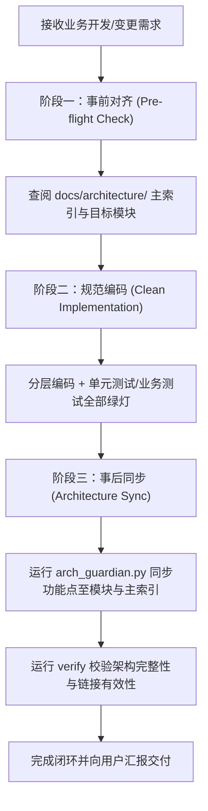

# 🛡️ Architecture Guardian (架构守护者)

本 Skill 旨在解决软件工程随业务迭代膨胀而导致“架构腐化（Architecture Drift）”及“AI 遗忘全局架构”的工程痛点。它通过建立**“事前查架构、事中遵规范、事后同架构”**的确定性双向闭环，确保项目的架构文档与真实业务代码始终保持强一致性。

---

## ⚡ 操作场景与直接执行边界规范 (Execution Boundaries)

为避免繁琐的交互，特对操作场景作如下严格边界划分：

1. **【场景 A：纯架构文档指令 (Direct Tooling Commands)】—— 立即直接执行，严禁出方案拦截**
   - **适用指令**：用户显式要求“初始化架构文档”、“生成/更新模块说明”、“同步架构变更”、“记录 ADR”、“校验架构完整性”等纯文档与元数据维护命令。
   - **行为准则**：此类指令属于**确定性辅助工具操作（Deterministic Tooling Execution）**，AI **必须直接运行 `arch_guardian.py` 或直接创建/更新目标 Markdown 架构文档**，执行完毕后直接展示生成的架构全景与文件链接，**严禁多此一举地输出等待确认的《实施方案》**！

2. **【场景 B：业务功能/代码开发 (Business Code Implementation)】—— 严格遵循前置方案确认**
   - **适用指令**：用户要求编写、重构或修改具体的工程业务代码（如 API、Controller、Service、领域模型、数据库持久化逻辑等）。
   - **行为准则**：严格执行全局架构红线，必须先向用户提供《业务功能实施方案》，经用户明确确认后再编写代码与测试，并在测试绿灯后进入本 Skill 的“阶段三”完成架构同步闭环。

---

## 核心工作流闭环 (The Two-Way Architecture Loop)



---

## 阶段一：事前架构对齐 (Pre-flight Check)

在动手编写或修改任何业务代码之前，**必须**先执行以下架构对齐步骤：

1. **检查工程架构目录**:
   检查工作区根目录是否存在 `docs/architecture/ARCHITECTURE.md`：
   - **若不存在**：优先执行初始化命令搭建架构骨架：
     ```bash
     python "<SKILL_DIR>/scripts/arch_guardian.py" --workspace "<项目绝对路径>" init --name "<项目名称>"
     ```
   - **若已存在**：必须先使用 `view_file` 阅读 `docs/architecture/ARCHITECTURE.md` 的全局分层与业务模块索引矩阵。

2. **定位业务归属与影响面**:
   - 判断本次需求是扩展**已有业务模块**还是引入**全新业务域**。
   - 若为已有模块，打开 `docs/architecture/modules/<module_name>/README.md`，理解已有业务流、领域模型与核心接口，**严禁破坏已有分层或重复造轮子**。

---

## 阶段二：规范编码与测试 (Implementation)

1. **坚持架构工程美学**:
   - 严格遵循项目的分层原则（如 Controller -> Service -> Repository / Infrastructure）。
   - 依赖注入，接口隔离，杜绝单体大文件（单文件建议 500 行以内，严禁超过 1000 行）。
2. **测试与质量闭环**:
   - 编写单元测试与业务集成测试，确保功能完整验证，无报错。

---

## 阶段三：事后架构增量同步 (Post-implementation Sync)

业务代码与测试编写验证完成之后，**必须**同步更新架构文档库，绝不能以“已完成代码”直接收工：

### 1. 全新业务模块同步 (New Domain Module)
若本次实现属于全新的业务模块，先创建该模块的标准化文档并自动注册在主索引：
```bash
python "<SKILL_DIR>/scripts/arch_guardian.py" --workspace "<项目绝对路径>" new-module <module_name> --title "<模块中文标题>" --domain "<所属业务域>" --desc "<模块核心职责简述>"
```
创建后，根据本次代码补充 `docs/architecture/modules/<module_name>/README.md` 中的业务流程图与核心类接口表。

### 2. 业务功能点增量同步 (Feature Sync)
将本次新增的具体业务功能点追加至模块文档，并自动同步至主索引 `ARCHITECTURE.md` 的最新变更流：
```bash
python "<SKILL_DIR>/scripts/arch_guardian.py" --workspace "<项目绝对路径>" sync-feature <module_name> --title "<功能点名称>" --desc "<业务逻辑实现简述及对外影响>" --code-ref "<核心代码入口类或文件路径>"
```

### 3. 架构完整性校验 (Integrity Verification)
在每次同步完成后，运行校验命令确保无断链与未登记模块：
```bash
python "<SKILL_DIR>/scripts/arch_guardian.py" --workspace "<项目绝对路径>" verify
```

---

## 交付汇报规范

在向用户汇报本次功能完成情况时，必须显式出示架构闭环成果：
1. **业务功能与代码变更说明**（含具体代码行 Markdown 链接）。
2. **已更新的架构文档链接**（如指向 [`ARCHITECTURE.md`](file:///path/to/docs/architecture/ARCHITECTURE.md) 与目标模块说明文件）。
3. **架构验证结果**（展示 `arch_guardian.py verify` 输出的 0 错误检查状态）。
