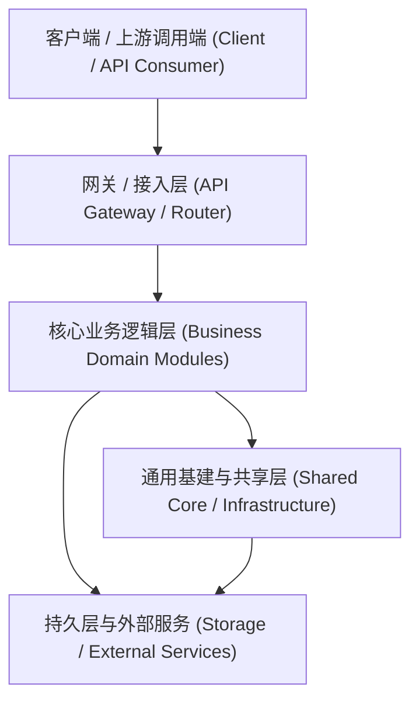

# {{PROJECT_NAME}} 系统架构全景说明书 (System Architecture Blueprint)

> **版本 (Version)**: 1.0.0  
> **更新时间 (Last Updated)**: {{CURRENT_DATE}}  
> **状态 (Status)**: 持续迭代 (Active Living Document)

---

## 1. 系统概述与设计愿景 (System Overview & Vision)
{{PROJECT_DESCRIPTION}}

---

## 2. 系统全局分层拓扑 (Global Architecture Topology)

### 2.1 分层架构规范 (Layering Guidelines)
1. **接口/接入层 (Presentation / Controller)**: 仅负责入参校验、协议转换与响应封装，严禁直接嵌入业务逻辑与数据持久化代码。
2. **业务域服务层 (Domain / Service)**: 承载核心业务规则与用例编排，遵循单一职责与高内聚，跨业务域交互必须通过接口/事件解耦。
3. **基础设施与数据层 (Infrastructure / Repository)**: 封装数据库、缓存、网络调用及第三方 API，对外提供抽象接口。
4. **共享与通用层 (Shared / Common)**: 存放无业务状态的工具类、通用常量、基础异常类与模型。

---

## 3. 技术栈与基础组件 (Tech Stack & Core Infrastructure)

| 类别 (Category) | 技术选型 (Technology) | 核心用途 (Purpose) |
| :--- | :--- | :--- |
| **编程语言 / 运行时** | {{RUNTIME_ENV}} | 核心开发与运行环境 |
| **开发框架** | {{FRAMEWORK}} | 核心服务与依赖注入框架 |
| **持久层 / 数据库** | {{DATABASE}} | 业务持久化数据存储 |
| **缓存 / 消息中间件** | {{CACHE_MQ}} | 缓存提速与异步解耦 |

---

## 4. 业务模块索引全景 (Business Modules Matrix)

<!-- MODULE_TABLE_START -->
| 模块名称 (Name) | 职责说明 (Description) | 详细架构文档 (Documentation) | 最后变更 (Last Updated) |
| :--- | :--- | :--- | :--- |
<!-- MODULE_TABLE_END -->

---

## 5. 架构决策记录 (Architecture Decision Records, ADR)

<!-- ADR_LIST_START -->
- [暂无决策记录]
<!-- ADR_LIST_END -->

---

## 6. 最近架构与功能变更流 (Recent Feature & Architecture Changes)

<!-- CHANGE_LOG_START -->
- `{{CURRENT_DATE}}`: 初始化系统架构全景与业务模块骨架。
<!-- CHANGE_LOG_END -->
