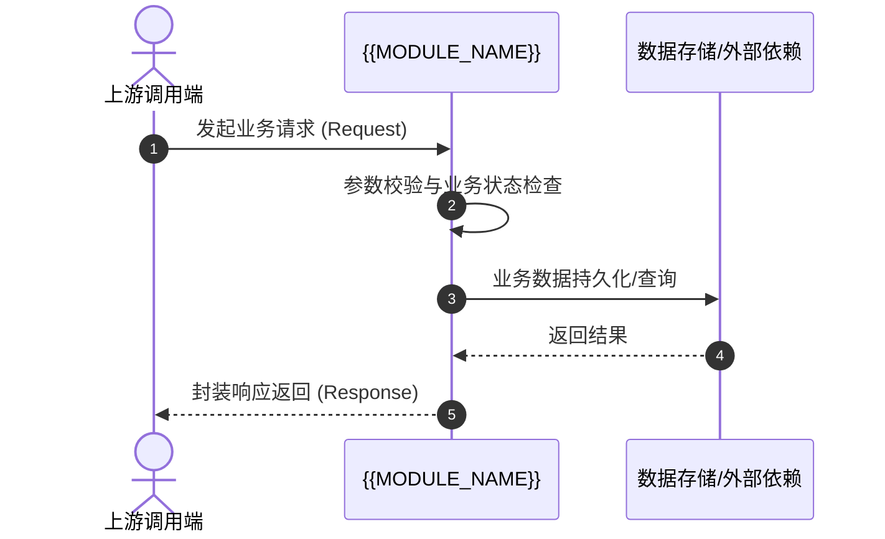

# 业务模块说明：{{MODULE_TITLE}} ({{MODULE_NAME}})

> **所属业务域**: {{MODULE_DOMAIN}}  
> **维护状态**: 活跃维护 (Active)  
> **最后更新日期**: {{CURRENT_DATE}}

---

## 1. 模块定位与业务职责 (Module Scope & Responsibility)
{{MODULE_DESCRIPTION}}

---

## 2. 核心业务流程与交互时序 (Business Flow & Sequence)

---

## 3. 已实现功能特性清单 (Implemented Features)

<!-- FEATURE_LIST_START -->
<!-- FEATURE_LIST_END -->

---

## 4. 关键设计、类与核心接口 (Core Interfaces & Domain Models)

| 分类 (Type) | 符号/类名 (Symbol / Class) | 代码路径 (Code Path) | 职责简述 (Role) |
| :--- | :--- | :--- | :--- |
<!-- SYMBOL_TABLE_START -->
<!-- SYMBOL_TABLE_END -->

---

## 5. 模块依赖与外部交互 (Dependencies & Interactions)

- **上游调用方 (Inbound Callers)**:
  - 接入网关 / 控制器接口
- **下游依赖组件 (Outbound Dependencies)**:
  - 共享基础设施 / 数据库访问对象
- **跨模块交互规范**:
  - 严禁直接读取其他业务模块的私有状态，须通过公开 Service 接口或领域事件通信。

---

## 6. 模块变更历史 (Change History)

<!-- MODULE_CHANGELOG_START -->
- `{{CURRENT_DATE}}`: 初始化业务模块架构说明文档。
<!-- MODULE_CHANGELOG_END -->
